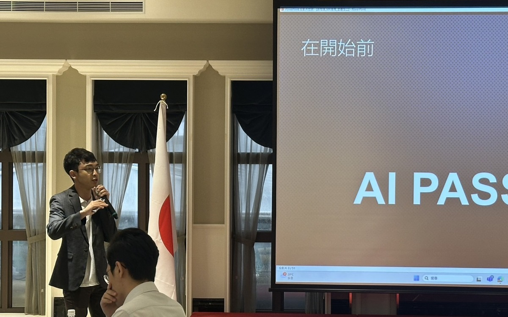

# LikeTech 萊客科技官網｜交付規格書

版本：v3（2026-11-03）
交付物：`liketech-site_20261103_v3.zip`
性質：純靜態網站（HTML／CSS／JavaScript），不需要建置流程（no build step）、不需要資料庫

---

## 0. 快速開始

### 0.1 本機預覽
不能直接雙擊打開 `index.html`。瀏覽器用 `file://` 開啟時會擋掉影片與 3D 模型，必須起一個本機伺服器：

```bash
cd liketech-site
python3 -m http.server 8080     # 或 npx serve .
# 打開 http://localhost:8080
```

### 0.2 部署
整個資料夾直接上傳到任何靜態主機，根目錄放 `index.html`。可用的主機例如 Nginx、Apache、S3 + CloudFront、Netlify、Vercel、Azure Static Web Apps、GitHub Pages。

- 不需要任何伺服器端程式
- 唯一的後端需求是聯絡表單，見 §6.1

---

## 1. 上線前必辦清單（Checklist）

| # | 項目 | 目前狀態 | 要做什麼 | 位置 |
|---|---|---|---|---|
| 1 | AI 顧問照片 ×2 | ⚠️ 示意圖（程式畫的投影片＋人影） | 換成真實活動照片 | §3.1 |
| 2 | 聯絡 Email | ⚠️ `hello@liketech.example` | 換正式信箱 | `index.html` 第 261 行 |
| 3 | 聯絡電話 | ⚠️ `02-0000-0000` | 換正式電話 | `index.html` 第 262 行 |
| 4 | 公司地址 | ⚠️ `台北市（示意地址）` | 換正式地址 | `index.html` 第 263 行 |
| 5 | 聯絡表單送出 | ⚠️ 只做前端驗證，不會真的寄出 | 串接後端 API 或表單服務 | §6.1 |
| 6 | 台灣燈塔作品截圖 | ⚠️ CSS 畫的示意畫面 | 補一張網站截圖 | §3.3 |
| 7 | 社群分享設定 | ⚠️ 未設定 `og:url`、`og:image` | 補上線網址與 1200×630 分享圖 | `index.html` `<head>` |
| 8 | 3D 列印成品圖風格 | ⚠️ 三張圖目前各是不同風格 | 選定一種後統一 | §3.6 |
| 9 | 網域與 HTTPS | — | 設定網域、SSL 憑證 | 主機端 |
| 10 | 網站分析（選配） | 未安裝 | 加 GA4／GTM 追蹤碼 | `index.html` `<head>` |

---

## 2. 檔案結構

```
liketech-site/
├── index.html                    頁面結構（所有區塊）
├── 規格書.md                      本文件
├── css/
│   └── main.css                  全站樣式（含 RWD）
├── js/
│   ├── main.js                   捲動動畫、服務切換、整合流程、手機選單、表單、Quest 3 模型
│   ├── showcase.js               六種服務的互動元件與「可替換資料」
│   └── ribbons.js                首頁與聯絡區的 WebGL 線條背景
├── vendor/                       第三方函式庫（已放本地，不依賴 CDN）
│   ├── gsap/                     GSAP 3.12.5 + ScrollTrigger
│   └── three/                    three.js r147 + GLTFLoader + RoomEnvironment（含 LICENSE）
└── assets/
    ├── img/brand/                品牌 logo（導覽列、favicon）
    ├── img/web/                  網頁開發作品截圖（10 張）
    ├── img/ai/                   AI 客服虛擬人物動畫
    ├── img/consult/              AI 顧問照片（⚠️ 待替換）
    ├── img/partners/             合作夥伴 logo（22 個，白色單色）
    ├── img/print/                3D 列印成品圖（3 張）
    │   └── alt-q/                備選：Q 版風格
    ├── video/                    App 操作影片（mp4 + 同名 jpg 封面）
    └── model/                    Meta Quest 3 3D 模型
```

---

## 3. 素材替換指南

> 通則：**檔名不變、直接覆蓋**是最簡單的替換方式，不需要改程式。
> 換完記得清瀏覽器快取或 CDN 快取。

### 3.1 AI 整合 → 「AI 顧問」照片 ⚠️ 必換

位置：服務區「04 AI 整合」輪播的第一張卡片。卡片上兩張照片每 4 秒自動交替，點開後顯示合作學校。

| 項目 | 規格 |
|---|---|
| 檔案 | `assets/img/consult/consult-1.jpg`、`consult-2.jpg` |
| 尺寸 | 建議 **1200 × 750 px**（16:10），最小 800 × 500 |
| 格式 | JPG，品質 80–85，單張建議 < 250 KB |
| 裁切 | 卡片以 `object-fit: cover` 置中裁切，主體放中間，上下約 10% 可能被裁掉 |
| 內容建議 | 1 張講師上課或工作坊全景、1 張學員實作特寫 |
| 數量 | 預設 2 張。要加第 3 張：複製一個 ``，並調整 CSS 的 `ga-fade` 動畫時間，見下方 |

**合作學校文字**在 `js/showcase.js` 的 `AI_ITEMS` 第一筆（約第 518 行）：

```js
{ t: 'AI 顧問', tag: 'Consult', ...
  d: '到校與企業開設 AI 導入工作坊與教師研習，從工具實作到教學應用一起陪跑。',   // ← 點開後的說明文字
  out: ['逢甲大學', '敏實科大', '中信科大', '花崗中學'],                          // ← 點開後的學校標籤
  art: '<div class="ga-photo">' +
       '</div>' +
       '<div class="ga-schools"><b>合作學校</b><span>逢甲大學</span>...</div>' }   // ← 卡片上的學校標籤
```

注意：學校名稱出現在 `out` 和 `art` 的 `ga-schools` **兩個地方**，增減學校時兩邊都要改。

### 3.2 AI 整合 → 「客服 Agent」虛擬人物

| 項目 | 規格 |
|---|---|
| 檔案 | `assets/img/ai/agent-cs.webp` |
| 目前 | 320 × 583 px，animated WebP，透明背景，76 格，約 4.4 秒循環 |
| 替換規格 | 去背人物，半身到膝上，**寬高比約 1:1.8**，寬 320–400 px |
| 格式 | 動態用 animated WebP（建議 < 1.5 MB）；靜態可用 PNG |
| 轉檔參考 | `ffmpeg -i input.gif -vf "scale=320:-1" -loop 0 -c:v libwebp_anim -q:v 70 -pix_fmt yuva420p agent-cs.webp` |

### 3.3 網頁開發 → 作品卡片（10 張截圖＋1 張示意）

資料在 `js/showcase.js` 的 `MOCKS` 陣列（第 16 行起），**由上到下就是卡片順序**：

| 順序 | 名稱 | 類型 | 檔案 |
|---|---|---|---|
| 1 | 敏實科技大學 | 大學官網 · AI 虛擬導覽員 | `web-minth.jpg` |
| 2 | 勞飢法 | 午餐集單平台 | `web-lunch.jpg` |
| 3 | 龍騰報名系統 | 競賽報名後台 | `web-lungteng.jpg` |
| 4 | 耘富科技 | 半導體設備企業官網 | `web-advanflo.jpg` |
| 5 | 台灣碳業能源 | 碳管理顧問官網 | `web-carbon.jpg` |
| 6 | DR.AI 冰櫃醫生 | IoT 溫控品牌官網 | `web-drai.jpg` |
| 7 | 珠寶商情 | 產業媒體入口網站 | `web-jewelry.jpg` |
| 8 | 麻津家 | 食品電商網站 | `web-majinchia.jpg` |
| 9 | 翔巧廣告設計 | 展場與廣告設計官網 | `web-xiangqiao.jpg` |
| 10 | 台灣燈塔 | 政府機關主題網站 | ⚠️ 無截圖，CSS 示意 |
| 11 | 松興生命禮儀 | 服務業品牌官網 | `web-songxing.jpg` |

| 截圖規格 | |
|---|---|
| 尺寸 | 寬 **1200 px**，高約 600–750 px（網站首頁第一屏） |
| 裁切 | `object-fit: cover; object-position: top center`，從頂部對齊，卡片比例約 14:9 |
| 格式 | JPG，品質 80–85，建議 < 200 KB |

新增一筆的寫法：

```js
{ title: '網站名稱', tag: '類型說明', html: '' },
```

補台灣燈塔：把該筆的 `html` 整段換成上面的 `` 寫法即可。卡片已依需求移除外部連結，只顯示名稱與類型。

### 3.4 App 開發 → 三支手機影片

資料在 `js/showcase.js` 的 `APPS`（約第 414 行），左→右為：敬請期待／BY My Roster（中間）／BY My Question。

| 檔案 | 目前規格 |
|---|---|
| `assets/video/app-soon.mp4` + `.jpg` | 480 × 990，4.6 秒 |
| `assets/video/app-roster2.mp4` + `.jpg` | 480 × 990，37.6 秒 |
| `assets/video/app-question.mp4` + `.jpg` | 480 × 990，27.5 秒 |
| `assets/video/load-roster.mp4` / `load-question.mp4` | 240 × 494（「軟體」卡片小手機上的載入畫面） |

- **規格**：H.264 MP4、**無聲**、寬高比約 1:2.06（已裁掉手機狀態列）、建議 < 2 MB；`.jpg` 為同名封面（第一格）
- **轉檔參考**：`ffmpeg -i in.mp4 -vf "crop=590:1216:0:64,scale=480:-2,fps=30" -an -c:v libx264 -preset veryfast -crf 26 -movflags +faststart out.mp4`
- **章節標籤**：`ch: [['行事曆', 0], ['排班', 4], ...]`，數字是秒數，點標籤會跳到該秒

### 3.5 合作夥伴 logo（跑馬燈，22 個）

位置：「四個階段兩週一次 Demo」區塊下方，兩排反向捲動，滑鼠移上去會暫停。

| 項目 | 規格 |
|---|---|
| 檔案 | `assets/img/partners/*.png` |
| 格式 | **白色單色＋透明背景 PNG**，高 120 px，寬依比例 |
| 顯示 | CSS 再套 `grayscale(1)`、透明度 62%，滑鼠移上去 100% |
| 新增 | 在 `index.html` 第 246 行起的 `.partners` 區塊，**兩個 `<ul class="pt-track">` 都要加**（第二個是無縫循環用的複本，`alt=""`） |
| 高度 | 每個 `` 有 `style="height:XXpx"`，依長寬比調整讓視覺份量一致：長條型約 33–40，方形約 55–60 |

轉白色單色的做法：Photoshop／Illustrator 把 logo 填滿白色後存透明 PNG；或用 ImageMagick：

```bash
magick in.png -alpha set -channel RGB -fill white -colorize 100 out.png
```

目前清單：
- 上排：中信科大、金屬中心、信邦電子、逢甲大學、騰雲集團、龍騰文化、國資圖、珠寶商情、扶輪、Advanflo、嘉義文化科技創新基地
- 下排：敏實科大、彰化師大、文化科技發展協會、NeuroBrain、Carbon Matrix、苗栗農改場、Dr.AI、LIGHTHOME、麻律家、松興、翔巧

### 3.6 3D 列印成品圖

| 檔案 | 目前風格 |
|---|---|
| `assets/img/print/print-ball.svg` | 鏤空籃球：質感渲染 |
| `assets/img/print/print-boat.svg` | 測試小船：扁平插畫 |
| `assets/img/print/print-dragon.svg` | 可動小龍：漸層光澤 |
| `assets/img/print/alt-q/*.svg` | 備選：Q 版（有表情） |

- **規格**：建議 400 × 340 比例、透明背景（SVG 或 PNG）。列印動畫完成後浮出顯示約 4 秒。
- **換成真實成品照片**：去背 PNG，寬 800 px，然後改 `js/showcase.js` 的 `MODELS` 中各筆 `photo` 路徑。
- 列印過程的線條動畫是程式依形狀即時計算，與成品圖無關，換圖不影響動畫。

### 3.7 品牌 logo

| 檔案 | 用途 |
|---|---|
| `assets/img/brand/brand-logo.png` | 導覽列 logo（256 × 284，透明背景）、Apple touch icon |
| `assets/img/brand/brand-icon-64.png` | 瀏覽器分頁圖示（favicon） |

- 品牌文字在 `index.html` 第 25 行：`<b>LikeTech</b><small>萊客科技</small>`
- 頁尾在第 300 行：`© 2026 萊客科技有限公司 LikeTech`

### 3.8 Meta Quest 3 模型

- **檔案**：`assets/model/quest3-data.js`（目前使用，base64 GLB）、`quest3.glb`（原始檔）
- **載入時機**：捲到「虛擬實境」才載入（lazy load）

---

## 4. 頁面結構與文案位置

| # | 區塊 | HTML id | 主要內容 | 主要程式 |
|---|---|---|---|---|
| 1 | 導覽列 | `.nav` | Logo、服務／整合／流程／聯絡、預約諮詢 | `main.js` nav |
| 2 | 首頁主視覺 | `#top` | 標題「從一行程式碼／到你拿在手上／的實體」，捲動後變「六種服務／一個團隊」 | `main.js` hero、`ribbons.js` |
| 3 | 三層卡片 | `#layers` | 「軟體 × AI × 線下互動」三張卡片落下、洗牌 | `main.js` layers timeline |
| 4 | 六種服務 | `#services` | 網頁／系統／App／AI 整合／虛擬實境／3D 列印 | `main.js` 的 `SVC`、`showcase.js` |
| 5 | 整合流程 | `#flow` | 小森食堂情境：AI 問答 → 官網 → 後台 → 虛擬互動／3D 紀念品 | `main.js` 的 `flowAt()` |
| 6 | 合作流程 | `#process` | 四個階段卡片（橫向捲動）＋合作夥伴跑馬燈 | `main.js` process |
| 7 | 聯絡 | `#contact` | 「說說你想做什麼」＋表單 | `main.js` 表單 |
| 8 | 頁尾 | `footer` | 版權 | — |
| 9 | 手機選單 | `#fab` | 右下角浮動按鈕（≤ 820px 才出現） | `main.js` mobile floating menu |

**服務說明文字**在 `js/main.js` 的 `SVC` 陣列（約第 32 行）：

```js
{id:'web', layer:0, name:'網頁開發', desc:'官網、電商與品牌網站，以下為實際上線作品。', hint:'拖曳或點擊切換作品'},
```

- `desc`：左側說明
- `hint`：藍色操作提示

**AI 整合 9 張卡片**在 `js/showcase.js` 的 `AI_ITEMS`，依序為：AI 顧問、知識庫問答、文件 OCR、會議紀錄摘要、客服 Agent、報價助理、影像瑕疵檢測、輿情監測、排班最佳化。

- 每筆欄位：
  - `t`：標題
  - `tag`：小標
  - `d`：點開後的說明
  - `out`：成效標籤
  - `art`：卡片畫面
- 排班最佳化的出勤月曆與人力覆蓋圖，是用 HTML/CSS 繪製（`SCHED_ART`），沒有使用圖片。

**整合流程（小森食堂）**是虛構示範情境，文字都在 `index.html` 第 114–233 行。

- 包含：餐廳名稱、菜色、價格、後台數字、吊飾上的「王小美 2026.08.10」。
- 吉祥物「森森」是 inline SVG（`<symbol id="mascot">`），菜色圖為 `dish-a/b/c`。

---

## 5. RWD（響應式）規格

| 斷點 | 行為 |
|---|---|
| > 900px | 桌機版：各區塊釘選捲動（pin）、左右分欄 |
| ≤ 900px | 服務區改為上方標題＋橫向分頁；三層卡片改縱向錯開堆疊；整合流程改為「上方裝置畫面固定（sticky）＋下方步驟捲動切換」 |
| ≤ 820px | 隱藏上方導覽連結，改用**右下角浮動選單按鈕**（z-index 9999，置頂所有內容），可跳到 6 個區塊並標示目前位置 |
| ≤ 700px | 網頁作品卡片改大張單卡、只疊 3 層；合作夥伴 logo 縮小 |
| ≤ 699px | 四個階段改為直向排列（不橫向捲動） |

**整合流程的裝置 mockup**：以固定尺寸繪製後依螢幕等比縮放，由 `main.js` 的 `fitDev()` 計算。

- 手機畫面為 300×620。
- 筆電畫面為 620×480。

**測試建議**：

| 平台 | 機型／版本 | 瀏覽器 |
|---|---|---|
| iOS | iPhone SE（375）、iPhone 15（393）、iPhone Pro Max（430） | Safari |
| Android | 360、412 寬 | Chrome |
| iPad | 820 寬 | — |
| 桌機 | 1280、1440、1920 | — |

**無障礙**：系統開啟「減少動態效果」時，動畫會關閉（`prefers-reduced-motion`）。

---

## 6. 後端與整合

### 6.1 聯絡表單 ⚠️

- **目前行為**：驗證姓名與 Email 後，只顯示「已收到（示意表單）」，**不會送出任何資料**。
- **串接位置**：`js/main.js` 標註 `TODO(後端)` 的地方（約第 229 行）。

表單欄位：

| 欄位 | id | 說明 |
|---|---|---|
| 姓名 | `fName` | 必填 |
| Email | `fMail` | 必填，格式驗證 |
| 需要的服務 | `s1`–`s6`（checkbox） | 網頁開發、系統開發、App 開發、AI 整合、虛擬實境、3D 列印 |
| 想解決的問題 | `fMsg` | 選填 |

串接選項：
- 自家 API（例如 `POST /api/contact` → 寄信或寫入 CRM）
- 表單服務（Formspree、Google Apps Script、Make/Zapier webhook）

範例：

```js
fetch('/api/contact', { method: 'POST', headers: {'Content-Type':'application/json'},
  body: JSON.stringify({ name: n, email: m, services: [...document.querySelectorAll('.chips input:checked')].map(i => i.nextElementSibling.textContent), message: document.getElementById('fMsg').value }) })
```

建議加上 reCAPTCHA 或 honeypot 防垃圾信。

### 6.2 外部依賴

| 項目 | 來源 | 說明 |
|---|---|---|
| 字型 | Google Fonts | Bricolage Grotesque、Noto Sans TC、JetBrains Mono。要完全自架可改用 woff2 |
| GSAP 3.12.5 | 本地 `vendor/gsap/` | 免費授權，商用網站也可使用（gsap.com/licensing） |
| three.js r147 | 本地 `vendor/three/` | MIT |

除字型外，不依賴任何外部 CDN 或 API。

---

## 7. 效能與快取

- **總容量**：約 13 MB。其中影片約 3 MB、Quest 3 模型約 3.6 MB、客服人物動畫約 1.2 MB。
- **Lazy load**：Quest 3 模型只在捲到虛擬實境時載入；合作夥伴 logo 使用 `loading="lazy"`。
- **快取建議**：

| 路徑 | 建議 |
|---|---|
| `assets/`、`vendor/` | 長快取，`Cache-Control: public, max-age=31536000` |
| `index.html`、`css/`、`js/` | 短快取，或改版時檔名加版本號（例如 `main.css?v=3`） |

- **伺服器設定**：記得開啟 gzip／brotli；影片需要支援 Range Request（一般靜態主機預設支援）。
- **Quest 3 模型可再瘦身**：正式主機可改成直接載入 `quest3.glb`，比 base64 小約 25%。改法見 `main.js`「Meta Quest 3 model」段落，用 `new THREE.GLTFLoader().load('assets/model/quest3.glb', cb)` 取代 `parse`。改完可刪除 `quest3-data.js` 與 `createImageBitmap` 的暫時處理。

---

## 8. 瀏覽器支援

- Chrome、Edge、Safari、Firefox 近兩年版本（iOS Safari 15 以上）。
- 虛擬實境的 GridScan 掃描效果需要 WebGL2；不支援的裝置會顯示靜態背景，不影響其他區塊。

---

## 9. 可刪除的舊程式

- `js/showcase.js` 的 `CONSULT` 與 `D.consult`：舊版獨立 AI 顧問輪播，目前未使用。
- `css/main.css` 的 `/* ai hub */`、`.consult`、`.cs-frame` 等樣式：同上。

---

## 10. 素材替換速查表

| 我要換… | 改這個檔案 | 規格 |
|---|---|---|
| AI 顧問照片 | `assets/img/consult/consult-1.jpg`、`-2.jpg` | 1200×750 JPG，主體置中 |
| AI 顧問合作學校 | `js/showcase.js` → `AI_ITEMS[0]` 的 `out` 與 `ga-schools` | 兩處都改 |
| 客服虛擬人物 | `assets/img/ai/agent-cs.webp` | 去背，約 1:1.8，animated WebP |
| 網頁作品截圖 | `assets/img/web/*.jpg` ＋ `MOCKS` | 寬 1200，首頁第一屏 |
| App 影片 | `assets/video/*.mp4` ＋ 同名 `.jpg` | 480×990，H.264，無聲 |
| 合作夥伴 logo | `assets/img/partners/*.png` ＋ `index.html` 兩個 `pt-track` | 白色單色透明 PNG，高 120 |
| 3D 列印成品圖 | `assets/img/print/*.svg` 或 `MODELS.photo` | 透明背景，400×340 比例 |
| 品牌 logo | `assets/img/brand/*` ＋ `index.html` 第 25 行 | 透明 PNG |
| 聯絡資訊 | `index.html` 第 261–263 行 | — |
| 服務說明文字 | `js/main.js` → `SVC` | — |
| 整合流程情境 | `index.html` 第 114–233 行 | — |
